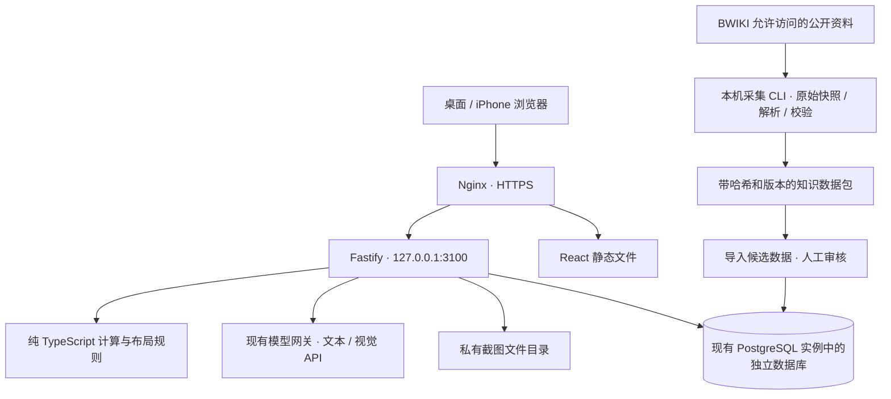

# 江南百景图 AI 规划平台：新项目方案

日期：2026-10-24。状态：供新项目评审和开发使用，尚未创建新应用或部署应用后端。

## 1. 目标和边界

建设个人使用、中文优先的游戏辅助 Web 应用。通过 Wiki 资料查询、手动录入游戏进度、生产计算、地图编辑、截图辅助录入和带来源的 AI 问答，帮助用户制定可执行的游戏计划。

现有入口 https://jnbjt.nerosun.cn/ 已上线独立静态占位页，DNS、Nginx、独立 HTTPS 证书已配置。新项目成熟后替换该入口。代码新建独立仓库，建议名 `jnbjt-planner`，不依赖 nero-agent 的代码或数据库表。

规划假设：初期仅本人和少数受邀用户使用；先做应天府；移动端可查资料、上传截图、看计划，复杂地图编辑先以桌面端为主。用户可调整这些假设。

不包含：Tauri、游戏账号登录或验证码接入、读取私有游戏接口、自动操作游戏、完整游戏复刻、付费服务、一次性还原所有城市、从单张截图精确恢复全城。

## 2. 架构选择

考虑过的方式：

| 方式 | 适用性与取舍 |
| --- | --- |
| 放进 nero-agent | 能复用部分登录、AI 管理，但游戏数据和发布周期与现有平台耦合；不选 |
| 独立 NestJS | 组织规范明确，当前小规模模块不需要额外框架层；用户已选择 Fastify |
| 独立 Fastify 模块化单体 | 一个后端进程、模块边界明确、可独立部署，推荐并作为本方案基础 |



前后端分离代码、同域部署：Nginx 直接提供前端，`/api/` 转发 Fastify。只有 API 监听一个独立本机端口，3100 是建议值，部署时先检查占用；不开放新的公网端口。

默认采集在本地 Mac 执行，减少 ECS 内存、CPU 和网络压力；页面查询和 AI 问答读取已发布知识库，不在用户每次提问时抓取 Wiki。

## 3. 技术栈和目录

| 层 | 选择 |
| --- | --- |
| 运行时 | Node.js 22，最低 22.13；初始化时选兼容安全补丁版本并固定，提交 lockfile |
| 仓库 | npm workspaces + TypeScript；不引入额外 monorepo 构建系统 |
| 前端 | React + Vite + React Router；TanStack Query 管理服务器数据 |
| 地图 | React-Konva；核心保存整数网格模型，与绘图引擎分离 |
| 后端 | Fastify 5；JSON Schema + TypeBox type provider 共享接口约束，初始化时核对包的兼容版本 |
| 数据库 | PostgreSQL 16，独立 `jnbjt` 数据库和应用账号；`pg` + 参数化 SQL + 编号迁移 |
| 采集 | Node.js fetch + Cheerio，CLI 形式；先 API，允许时才使用页面 HTML |
| AI | 一个模型适配层，调用已配置的 OpenAI 兼容网关；模型能力需实际探测 |
| 测试 | Vitest，Fastify inject，独立测试库，Playwright 少量核心流程 |
| 运行 | ECS 一个 systemd 服务；复用现有 Nginx、PostgreSQL，不再启动整套基础设施 |

Fastify 原生 schema 可用于请求验证和响应序列化，type provider 可由 schema 推导类型。[官方文档](https://fastify.dev/docs/latest/Reference/Type-Providers/)

React-Konva 支持 React 声明式 Canvas，适合网格、拖动、图层和选择；第一版使用几何建筑块，不依赖游戏美术资产。[官方文档](https://konvajs.org/docs/react/index.html)

```text
jnbjt-planner/
  apps/
    web/src/
      features/{auth,knowledge,cities,production,editor,assistant,imports}/
    api/src/
      app.ts                  # 构建 Fastify，方便 inject 测试
      server.ts               # 启动、关闭和信号处理
      plugins/{config,db,auth,uploads}.ts
      modules/{knowledge,cities,production,layouts,ai,jobs,imports}/
  packages/
    contracts/src/            # TypeBox 请求响应 schema；禁止依赖 DB 和密钥
    domain/src/               # 生产、网格、加成、方案校验的纯函数
    knowledge-import/src/     # Wiki 访问、快照、解析、归一化、审核候选
  scripts/                    # migrate、create-user、wiki-sync、import-bundle
  migrations/
  tests/{fixtures,integration,e2e}/
  deploy/                     # Nginx、systemd、发布与回滚说明
  docs/
```

未来若计算量明显上升，只把计算任务执行器拆为 Worker；不用现在拆微服务。第一版不引入 Redis、Elasticsearch、独立向量数据库、LangChain 或 Mastra。复杂多步骤智能体出现后再评估 Mastra，届时必须先加载对应版本的 mastra skill。

## 4. Wiki 核查结果和采集边界

已于 2026-10-24 进行只读抽样：

- 首页能访问；包含城市、生产、雕像等入口。[来源](https://wiki.biligame.com/jiangnan/首页)
- `api.php?action=query&meta=siteinfo&format=json` 成功，返回 MediaWiki 1.37.0。
- `api.php?action=parse&page=农田&prop=text|revid&format=json` 成功，抽样返回 revision 64284、约 104425 字符 HTML，包含表格；这是当次结果，不是未来固定版本。
- 生产目录页提醒数据不完整，因此页数和抓取成功率不能代表规则完整性。[来源](https://wiki.biligame.com/jiangnan/生产)
- 同名餐馆存在城市分支；农田页面含不同生产档位，部分数量以复合表达式呈现。不能把所有表格数字直接压平为单一数值。[餐馆](https://wiki.biligame.com/jiangnan/餐馆)、[农田](https://wiki.biligame.com/jiangnan/农田)

当次 robots.txt 可读取，禁止路径包括 `/*index.php?*`、`/*oldid=*`、部分文件/用户/模板/特殊页面等。必须在采集运行时重新读取并对完整 URL 检查；不得把同一内容换 URL 作为规避方式。API 没有被当次规则显式禁止，不等于站方授予批量采集或再分发授权；初始化时另核站点规则。保留 revision 元数据即可，不请求被禁止的历史修订 URL。[robots.txt](https://wiki.biligame.com/robots.txt)

首页声明 Wiki 遵循 CC BY-NC-SA，链接实际指向 3.0；特殊注明内容除外，并单独说明游戏素材权利归属。方案按个人非商业用途设计；保留标题、来源链接、作者/贡献者或历史页入口、许可版本、采集与修改说明。公开分发改编资料时核对相同方式共享要求，代码许可与资料许可分别记录。若后续收费或使用游戏美术，先确认适用授权，不能把 Wiki 的文字许可当成全部素材许可。[首页声明](https://wiki.biligame.com/jiangnan/首页)、[许可条款](https://creativecommons.org/licenses/by-nc-sa/3.0/)

### 采集策略

1. **先做探针**：记录 robots、API 能力、允许的页面类型，抽样 10–20 页；首页、生产目录、目标城、目标建筑、雕像为首批种子。
2. **范围有限**：只遍历审核过的种子、分类和必要详情；解析时删除页内全站导航，防止一个建筑页扩展成全站抓取。第一批最多 100 个候选页面，达到上限停下并报告。
3. **低频读取**：并发 1，连续请求间隔至少 3 秒加少量抖动，初始每次最多 100 请求；这是自定保守上限，不是站方承诺的限额。遵循更严格的站点限制。标识真实工具 User-Agent；联系信息由项目主人提供，不编造。
4. **退避和停止**：超时 20 秒，网络错误及 5xx 最多 3 次退避；429 尊重 Retry-After，连续触发停止；403、验证码、登录要求或规则不允许时停止该来源，不做代理轮换或反爬绕过。
5. **保存快照**：按页流式写压缩快照，记录 URL、页面 ID、revision、获取时间、内容哈希、parserVersion、robots 检查结果；保留原始 HTML 和清洗正文，默认不批量下载图片。
6. **先解析再审核**：Cheerio 基于标题、表头、表格关系、图片 alt/title/file name 解析。保留 rowspan/colspan 语义和图片表达的单位；不能只取 textContent。
7. **版本发布**：导入暂存区，输出新增/修改/缺失报告；审核关键数值后发布知识版本，失败保留旧版。重复导入同一内容不新增实体，不覆盖人工修正。
8. **增量同步**：初期手动 CLI，每周一次是建议频率；后续可用 recentchanges（仅当站点允许且实际支持），需完整处理 continuation，维护时间游标和去重。模板改动也可能改变页面输出，因此定期对允许清单重新解析并比对 hash，不能只盯主体 revision。

API 支持、低并发、缓存、描述性 User-Agent 的原则参考 [MediaWiki API etiquette](https://www.mediawiki.org/wiki/API:Etiquette)。最近更改只是增量发现手段，本站参数兼容性需要另测。[RecentChanges](https://www.mediawiki.org/wiki/API:RecentChanges)

## 5. 知识库：事实表和文本检索共同使用

精确计算读取审核后的结构化事实；攻略解释检索文本段落。AI 生成的句子不能回写为游戏事实。

### 5.1 三类数据

| 数据 | 例子 | 发布标准 |
| --- | --- | --- |
| 来源资料 | 页面、标题、章节、表格、来源 revision | 保留来源、许可和时间 |
| 结构化规则 | 建筑占地、配方、投入产出、生产耗时、加成适用条件 | schema 和跨字段校验，关键数值人工核验 |
| 私人存档 | 当前城、库存、建筑等级、地图、截图 | 用户拥有、鉴权访问，不混进公共知识 |

未知使用 null/unknown，不能用 0 填充；“无消耗”“未采集”和“规则不明”是不同状态。保留原始值与解释，尤其是加法表达式、概率奖励和条件奖励。未确认的修正项不用于精确计算。

### 5.2 核心数据模型

| 表 / 实体 | 责任 |
| --- | --- |
| users、sessions | 邀请/管理员开户，独立登录会话 |
| source_pages、source_snapshots | 规范 URL、来源标题、许可、revision、hash、抓取状态和快照路径 |
| knowledge_imports、knowledge_versions | 数据包、审核差异、激活版本；发布事务和回退 |
| knowledge_chunks | 章节正文、实体关联、来源快照、出处 |
| entity_aliases | 标准名、别名、OCR 常见误识别，按实体和城市区分 |
| cities、building_types、resources | 游戏静态实体，不包含个人进度 |
| building_variants、production_recipes | 城市/等级/档位等适用条件，时长秒、工人、投入和产出 |
| effect_rules、entity_evidence | 经过验证的加成规则、字段级来源、人工确认状态 |
| player_cities、resource_balances、building_instances | 玩家当前存档，所有记录带 user_id 或可验证的所属链 |
| layouts | schemaVersion、知识版本、整数网格、建筑位置、布局版本 |
| uploads、recognition_drafts | 私有截图、识别候选、校正记录，不直接改存档 |
| jobs、assistant_runs | 长任务状态、结果、引用、模型与规则版本 |

逐个里程碑新增必要表，不在第一个提交建完所有表。通用 evidence 采用实体 ID + 字段路径 + snapshotId，允许同一规则多来源和人工覆盖；来源更新后标记冲突，不悄悄覆盖人工值。

`production_recipes` 必须区分建筑建造时间、升级时间和生产时间；同名跨城建筑以稳定 ID 区分。每条配方包含输入/输出数组、时间秒、建筑等级范围、档位、工人数、已知负责人条件、确定/条件奖励、规则确认状态。

### 5.3 检索方案

第一版：标准名/别名精确匹配 → 城市与实体筛选 → 中文查询词拆分和受控关键词扩展 → 标题/章节/正文检索 → 取相关段落生成答案。可用 PostgreSQL pg_trgm 辅助名称相似检索；对两字词和无可提取 trigram 的情况走精确/LIKE 降级。不要假设 PostgreSQL 默认全文检索自动做好中文分词。[pg_trgm 文档](https://www.postgresql.org/docs/16/pgtrgm.html)

正文按标题层级切块，建议每块 500–1000 中文字符并带实体名；完整表格行不能从单位和表头拆开。初始只放 5–8 段到模型上下文，总长度设限。答案区分 Wiki 事实、程序计算、AI 建议，引用真实可访问来源链接。

暂不配置 embedding。准备 30 条真实问题评估后，如关键词检索明显漏召回，再加外部 embedding + PostgreSQL pgvector，与现有检索融合。不得假设现有模型网关一定支持 embedding。

## 6. 核心功能设计

### 6.1 城市存档

用户选择城市，手动录入知府等级、已解锁区域、建筑数量/等级、库存、工人等。允许 JSON 导入/导出，带 schemaVersion。保存使用版本号乐观锁，过期版本返回 409，避免多标签页覆盖。服务器校验所有地图和库存，不信任客户端计算。

### 6.2 生产计算

先解决“还缺多少资源、要做几轮、适合哪个档位”，再做复杂的多资源排程。

- 输入：城市快照、目标库存、时间范围、可用建筑、工人、上线/收菜频率、明确选定的加成。
- 已审核规则下计算轮数和材料缺口，单配方确定产出可用 `ceil(缺口 / 每轮产出)`；涉及资源消耗链时必须递推投入，检测循环依赖和缺失配方。
- 第一版支持用户指定配方及有限已验证链路；出现循环依赖、未知奖励、未经验证的加成或缺失工人条件时返回“需补充”，不声称已自动求出可行排程。
- 排程考虑共享库存、并行建筑、工人占用、建筑等级、收菜时间和仓储限制；暂时不支持的约束要明确列在结果假设中。
- 不把多个加成一律相加；按规则记录加成对象、适用阶段、组合方式和取整顺序。每种规则有样例和测试。
- 输出：缺口表、轮数、投入、理论工作时长、考虑收菜间隔的估计日历时间、阻塞项和假设。理论耗时与现实可完成时间分开显示。

计算由 `packages/domain` 纯函数执行；AI 只解析目标和解释结果。重计算使用同一份库存/规则/布局版本以便复现。

### 6.3 地图编辑与布局建议

阶段一使用可配置正交整数网格：可用地形、锁定区、道路、建筑矩形、雕像。支持拖动、吸附、旋转（仅规则允许）、碰撞、越界、锁定位置、撤销重做、保存与导出 PNG/JSON。暂不追求游戏贴图和等距美术效果。

地图底图的精确可建格、雕像形状与覆盖判定必须从样本和玩家验证得到；未知城市使用“自定义练习地图”，不能标成精确还原的游戏地图。加成范围采用离散格集合/已验证几何规则，并保留“相交/完全覆盖/锚点”等判定语义，不能凭视觉默认圆形范围。

阶段二提供局部启发式建议：固定雕像/锁定建筑，在可建格枚举候选位置，先验证硬约束，再评估覆盖、产能或道路等选定目标。先返回一个可行候选与差异，不宣称全局最优。独立校验器必须复查算法结果；无法找到方案时保留原布局。

CPU 任务按真实地图基准设置预算，超过预算或出现事件循环阻塞才引入 worker_threads。Worker 从模块化单体调用，无需 Redis 或第二个常驻服务。

### 6.4 截图辅助导入

手机上传 → 校验并重编码 → 用户选目标城市/页面类型 → 视觉模型识别 → 映射标准实体 → 表格校正 → 用户确认应用差异。

优先识别资源面板、建筑详情和生产面板。全城地图截图只作参考或覆盖图，单张截图不承诺准确格坐标、隐藏建筑或未显示区域。多个截图重叠、跨时间拍摄时不能直接累加资源和建筑。

初始仅 JPEG/PNG/WebP，单张最多 10 MiB，最多 2000 万像素；HEIC 明确提示先转换，后续再加解码能力。校验文件签名与解码尺寸，纠正旋转、去掉 EXIF；缩小上传模型的副本，原图私有且可删除。模型未提供可校准置信度时不用虚假的“98%”，改为“待核验/有证据匹配/用户确认”。

识别结果是有 schema 的草稿，包括值、原文、候选实体、证据位置；识别不确定处留空。只有用户确认后才能事务性写入存档，带版本校验。

### 6.5 AI 助手

AI 可使用受控内部函数：`searchKnowledge`、`getCitySnapshot`、`calculateProduction`、`validateLayout`、`proposeLayout`。仅后端执行；不得获得 shell、任意 URL 抓取、数据库写 SQL 或云服务器管理能力。

第一版优先明确工作流：识别问题 → 检索/计算 → 输出结论和来源，最多两轮补充查询。修改城市或布局只返回草稿/差异，由用户确认，不允许模型直接写入。

模型输出必须按 schema 验证；不存在的建筑/来源 ID 拒绝使用。把 Wiki 文本、图片识别文本当资料，不当系统指令。答案带来源快照、知识版本、存档版本、模型 ID 和调用时间。模型不可用时，资料查询、手动编辑和确定性计算继续可用。

## 7. API 草案

统一前缀 `/api/v1`。响应错误包含稳定 code、message、requestId，服务端日志不记录密码、Cookie、模型 Key 或图片二进制。

| 接口 | 用途 |
| --- | --- |
| GET /health；GET /ready | 进程与数据库就绪，公开结果不暴露环境变量 |
| POST /auth/login；POST /auth/logout；GET /auth/me | 独立会话 |
| GET /knowledge/search；GET /buildings/:id | 资料检索与详情 |
| GET/POST /cities；GET/PUT /cities/:id | 玩家存档，PUT 携带 version |
| POST /production/calculate | 确定性计算 |
| GET/PUT /cities/:id/layout | 布局与版本 |
| POST /layouts/validate | 硬约束验证 |
| POST /uploads；GET/DELETE /uploads/:id | 鉴权私有截图 |
| POST /recognition-jobs；POST /layout-jobs | 返回 202 与 jobId |
| GET /jobs/:id；POST /jobs/:id/cancel | 状态、结果、取消 |
| POST /assistant/runs | 创建受控问答任务，沿用 jobs 查询 |
| POST /recognition-drafts/:id/apply | 用户确认后应用 |

数据采集与知识发布第一版采用本地 CLI，不开放匿名同步接口。后续管理页如有需要，只管理员可用。

长任务使用 PostgreSQL jobs 表：状态 queued/running/succeeded/failed/cancelled，带 userId、idempotencyKey、leaseExpiresAt、attempts、result、error。单进程执行器采用事务认领和租约；重启后恢复过期任务，外部模型超时重试可能再次计费，必须限制重试并标识情况。取消后即使外部请求已经完成，也不得应用结果。先用轮询，SSE 作为体验优化后加。

## 8. 登录、文件和数据隔离

独立管理员开户，不复用 nero-agent 的 Cookie 或直接访问其用户表。使用成熟的密码哈希实现，HttpOnly + Secure + SameSite Cookie，Cookie 省略 Domain，仅限 jnbjt 主机。写请求检查 Origin/CSRF，登录和 AI 接口限流；所有私人资源服务端校验 userId，不能只靠不可猜 ID。

模型 Key 仅存服务器环境文件，前端只看到模型名称和能力。截图存于 Nginx 静态根之外，通过鉴权 API 流式提供；模型服务是否支持视觉需要单独测试，上传前明确图片会发往所配置模型服务。

Wiki 内容清洗后以文本/受控 Markdown 展示，禁止原始脚本、iframe 和任意 HTML 执行。采集器只允许明确来源域与路径，校验重定向，防止导入文件中的 URL 把服务端引向内网。

## 9. ECS 部署和运行预算

当前机器资源有限且服务共享；下面是初始配置目标，不能代替上线实测：

- 后端一个进程，绑定 `127.0.0.1:3100`；数据库连接池上限 3，连接超时与空闲回收显式设置。
- AI/视觉/布局长任务执行并发总数 1，避免三个模块各自并发 1 叠加；每用户排队上限 10。
- Node old-space 初始 192 MiB；需独立统计 RSS、原生图片内存和 Worker 内存，不能把 heap 上限当进程总内存。
- 后端 RSS 目标不高于约 300 MiB；上线前测现有服务峰值与可用内存，再决定 systemd MemoryHigh/MemoryMax，不直接照抄硬限制导致 OOM。
- 第一版应用数据软配额 1 GiB，单用户截图 200 MiB，日志轮转，明确区分“用户删除”与“备份到期”。原始 Wiki 快照主要留在本地；ECS 只放活跃知识版本和必要来源文本。
- 自动采集默认关闭；本机离线采集并生成数据包，ECS 导入校验即可。

建议目录：

```text
/opt/jnbjt/releases/<release>/api/
/opt/jnbjt/releases/<release>/web/
/opt/jnbjt/current -> releases/<release>
/etc/jnbjt/jnbjt.env
/var/lib/jnbjt/uploads/
/var/backups/jnbjt/
/etc/nginx/sites-available/jnbjt   # 沿用已部署站点与现有证书
```

独立低权限系统用户 `jnbjt`，通过 systemd 托管。发布在本机/CI 构建，上传 Linux 可运行后端与 Web，执行迁移、健康检查、原子切换，最后验收；不在低内存 ECS 上执行全量安装和前端构建。若依赖图片原生库，产物必须在 Linux/amd64 环境准备，不能上传 Mac 的 node_modules。

Nginx 保留当前证书和 HTTP 跳转，仅在 HTTPS server 中加入 `/api/` 代理并更新静态 root；代理保留 `/api/v1` 路径、请求 ID、正确转发头及上传大小。上传总 body 限制可设 12 MiB，应用仍坚持单文件 10 MiB。Fastify trustProxy 只信任本机 Nginx。

为 jnbjt 独立备份数据库、截图及活跃知识版本，每日备份并设置保留期；仅同盘备份无法覆盖磁盘故障，条件允许时加一份异地副本。首次上线必须完成一次恢复演练。回滚切回旧应用/前端并保留用户数据；迁移采用向后兼容的增加式变更，不自动回滚数据库。

## 10. 开发里程碑和验收

| 阶段 | 交付物 | 必须通过的验收 |
| --- | --- | --- |
| P0 来源验证 | API 探针、20 个以内样本、许可和 robots 记录、关键字段覆盖报告 | 证明目标城资料能解析；缺少的数据有列表；此阶段可因数据不足调整范围 |
| P1 可用资料站 | 新仓库、前后端、独立登录、迁移、知识导入与检索 | 未登录访问私人 API 为 401；每条已发布事实可追溯来源；重复导入不重复；手机能查 |
| P2 存档与生产计算 | 手动城市存档、库存、配方选择、缺口与耗时计算 | 真实规则样例计算一致；未知/循环依赖明确拒算；多用户隔离和 409 冲突通过 |
| P3 地图编辑 | 网格、建筑、道路、校验、撤销、保存、JSON/PNG 导出 | 越界/碰撞阻止；保存重开一致；未知底图不会伪装成官方地图 |
| P4 带来源 AI | 资料检索 + 规则计算 + 回答，降级和成本限制 | 30 个基准问题；无来源 ID 不伪造引用；所有关键数值引用或来自程序结果 |
| P5 截图辅助录入 | 资源/建筑面板识别、校正、确认应用 | 至少 20 张自有截图；逐字段准确率与拒识率报告；确认前存档不变 |
| P6 局部布局建议 | 已验证雕像规则、可行候选、目标评分、差异确认 | 候选全过独立约束检查；超时不阻塞 API；不宣称全局最优 |
| P7 稳定上线 | 发布、备份恢复、任务恢复、手机与桌面验收 | HTTPS、401、归属隔离、重启恢复、回滚以及现有服务检查通过 |

推荐第一个实际发布范围：P0–P2，先成为能查、能存、能算的工具；地图、AI、截图按阶段添加。Wiki 数据覆盖和真实截图质量是主要不确定性，暂不承诺精确工期。

## 11. 测试重点与发布门槛

1. 采集器：robots 禁止路径、重定向、429、API JSON error、缺字段、模板导航污染、图片单位、rowspan、城市分支、单位换算、重复导入和人工覆盖。
2. 计算：库存边界、零产出、取整、多轮投入、城市限制、加成顺序、未知条件、循环配方和共享工人。合成规则测试必须标记合成，真实规则测试有来源版本。
3. 地图：旋转后尺寸、边界、不可建地、道路、锁定位置、雕像覆盖判定；坐标和导出导入往返不漂移。
4. 私人数据：不同用户不能读取截图/存档/任务；越权修改失败；Cookie 隔离、CSRF、文件解码炸弹和配额检查。
5. 任务：进程中断、租约过期、取消、重复提交、模型超时、客户端离线。任务结果不得越过确认步骤。
6. AI：提示注入资料、未知建筑、过期知识、跨城混淆、来源不存在、模型无视觉能力。先保留检索结果和确定性计算，不拿流畅文风当准确性。

## 12. 新项目启动说明

建议把本文件放进新仓库 `docs/design.md`，开发计划放 `docs/implementation-plan.md`，后续决定记入 `docs/decisions.md`。初始化时先核对依赖版本、Fastify 插件兼容性与 ECS 运行时，不继承其他项目无关 AGENTS.md。

可直接使用的启动提示：

> 请依据 docs/design.md 和 docs/implementation-plan.md 创建江南百景图规划工具。使用 React + Vite + TypeScript、Fastify 5、PostgreSQL，采用 npm workspaces 模块化单体。先完成 P0 的 BWIKI 小样本采集验证与覆盖报告，再交付 P1–P2；先不做地图自动优化、全城截图还原或复杂 Agent。保留数据来源、许可、版本与人工审核，AI 不编造游戏数值。复用 jnbjt.nerosun.cn 已有站点和证书，后端建议监听 127.0.0.1:3100，部署前检查端口；不要修改 nero-agent 的应用、数据库或登录体系。每个阶段提供可运行结果、检查命令和实际验收证据。生产部署在产物可审阅、检查通过后执行。

以上是方案，不是已实现功能。已有线上成果仍仅为静态占位站。
